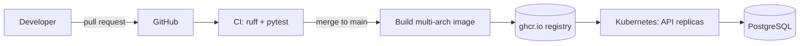

# TaskBoard

[](https://github.com/tamezza/TaskBoard/actions/workflows/ci.yml)


TaskBoard is a task-management application: a REST API where you create tasks, list them, and mark them as done, with the data stored in PostgreSQL.

It is built with **FastAPI** and comes with a complete delivery chain: automated tests, CI/CD pipelines, a published Docker image, and a Kubernetes deployment. The application is deliberately simple, because the focus of the project is everything around it: how a change goes from a pull request to a tested, packaged and deployed service.

## Architecture



## Stack

| Area | Tools |
|---|---|
| API | Python 3.13, FastAPI, Pydantic, SQLAlchemy |
| Database | PostgreSQL 17 (SQLite by default for local runs and CI) |
| Tests and quality | pytest, ruff |
| CI/CD | GitHub Actions, Jenkins |
| Containers | Docker, Docker Compose |
| Orchestration | Kubernetes (kind for local clusters) |

## API

| Method | Path | Description |
|---|---|---|
| GET | `/health` | Health check, used by the Kubernetes readiness probe |
| GET | `/tasks` | List all tasks |
| POST | `/tasks` | Create a task (`{"title": "..."}`) |
| GET | `/tasks/{id}` | Get one task, 404 if it does not exist |
| PATCH | `/tasks/{id}/done` | Mark a task as done |

Interactive documentation is generated by FastAPI at `/docs`.

## Quick start

### With Docker Compose (API + PostgreSQL)

```bash
docker compose up --build -d
curl -X POST http://localhost:8000/tasks \
  -H "Content-Type: application/json" -d '{"title": "first task"}'
curl http://localhost:8000/tasks
docker compose down
```

Data is stored in a named volume, so tasks survive `docker compose down` and `up`.

### From the published image

```bash
docker run --rm -p 8000:8000 ghcr.io/tamezza/taskboard:latest
```

### Locally, without Docker

```bash
python3 -m venv .venv && source .venv/bin/activate
pip install -r requirements.txt -r requirements-dev.txt
uvicorn app.main:app --reload
```

Without a `DATABASE_URL` environment variable, the API uses a local SQLite file.

## Tests

```bash
ruff check .
python -m pytest -v
```

## CI/CD

The pipeline is defined in [`.github/workflows/ci.yml`](.github/workflows/ci.yml).

- **On every pull request:** lint with ruff and run the tests. The `main` branch is protected: a pull request and a passing `test` check are required to merge.
- **On every push to `main`:** after the tests pass, build the Docker image for `linux/amd64` and `linux/arm64` and push it to `ghcr.io/tamezza/taskboard`, tagged `latest` and with the commit SHA. The SHA tag makes every build traceable and allows rollbacks.

The same install, lint and test stages are also available for Jenkins in the [`Jenkinsfile`](Jenkinsfile). The image for a Jenkins server with Python is in [`jenkins/Dockerfile`](jenkins/Dockerfile).

## Kubernetes

The manifests in [`k8s/`](k8s) deploy PostgreSQL and three replicas of the API behind a Service.

```bash
kind create cluster --name taskboard --config k8s/kind-config.yaml
kubectl apply -f k8s/db.yaml
kubectl rollout status deployment/db
kubectl apply -f k8s/api.yaml
kubectl rollout status deployment/taskboard
kubectl port-forward service/taskboard 8000:80
```

What the deployment demonstrates:

- **Self-healing:** a deleted pod is replaced automatically to keep three replicas.
- **Rolling updates:** new pods must pass the `/health` readiness probe before old ones are removed, so there is no interruption.
- **Rollback:** `kubectl rollout undo deployment/taskboard` returns to the previous version.
- **Shared state:** all replicas use the same PostgreSQL database, so every request sees the same data.

## Project structure

```
app/                  FastAPI application (main.py) and database models (db.py)
tests/                API tests
.github/workflows/    GitHub Actions pipeline
jenkins/              Dockerfile for a Jenkins server with Python
k8s/                  Kubernetes manifests and kind cluster configuration
Dockerfile            Image of the API
compose.yaml          Local stack: API + PostgreSQL
Jenkinsfile           Jenkins pipeline
```

## Known limitations and roadmap

- Database credentials are written in plain text in `compose.yaml` and `k8s/`. This is acceptable for local development only; they will move to secrets.
- Planned next steps: cloud deployment (AWS), infrastructure as code (Terraform), monitoring (Prometheus, Grafana), and security scanning in the pipeline.

## Author

**Thiziri Amezza** · [GitHub](https://github.com/tamezza) · [LinkedIn](https://www.linkedin.com/in/amezzathiziri/)