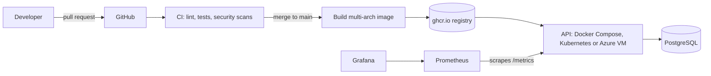

# TaskBoard

[](https://github.com/tamezza/TaskBoard/actions/workflows/ci.yml)


TaskBoard is a task-management application: a REST API where you create tasks, list them, and mark them as done, with the data stored in PostgreSQL.

It is built with **FastAPI** and comes with a complete delivery chain: automated tests, CI/CD pipelines with security scans, a published Docker image, a Kubernetes deployment, cloud infrastructure defined with Terraform, and monitoring with Prometheus and Grafana. 

## Architecture



## Stack

| Area | Tools |
|---|---|
| API | Python 3.13, FastAPI, Pydantic, SQLAlchemy |
| Database | PostgreSQL 17 (SQLite by default for local runs and CI) |
| Tests and quality | pytest, ruff |
| CI/CD | GitHub Actions, Jenkins |
| Containers | Docker, Docker Compose |
| Orchestration | Kubernetes (kind for local clusters) |
| Cloud and infrastructure as code | Microsoft Azure, Terraform, cloud-init |
| Monitoring | Prometheus (metrics and alert rule), Grafana (provisioned dashboard) |
| Security | pip-audit, Trivy, Dependabot, non-root container, secrets outside the repository |

## API

| Method | Path | Description |
|---|---|---|
| GET | `/health` | Health check, used by the Kubernetes readiness probe |
| GET | `/tasks` | List all tasks |
| POST | `/tasks` | Create a task (`{"title": "..."}`) |
| GET | `/tasks/{id}` | Get one task, 404 if it does not exist |
| PATCH | `/tasks/{id}/done` | Mark a task as done |
| GET | `/metrics` | Prometheus metrics (request counts and durations) |

Interactive documentation is generated by FastAPI at `/docs`.

## Quick start

### With Docker Compose (API, PostgreSQL, Prometheus, Grafana)

The database password is read from an untracked `.env` file:

```bash
cp .env.example .env        # then set your own POSTGRES_PASSWORD in .env
docker compose up --build -d
curl -X POST http://localhost:8000/tasks \
  -H "Content-Type: application/json" -d '{"title": "first task"}'
curl http://localhost:8000/tasks
docker compose down
```

| Service | Address |
|---|---|
| API | http://localhost:8000 |
| Prometheus | http://localhost:9090 |
| Grafana | http://localhost:3000 (default login `admin` / `admin`) |

Data is stored in a named volume, so tasks survive `docker compose down` and `up`.

### From the published image

```bash
docker run --rm -p 8000:8000 ghcr.io/tamezza/taskboard:latest
```

### Locally, without Docker

```bash
python3 -m venv .venv && source .venv/bin/activate
pip install -r requirements.txt -r requirements-dev.txt
uvicorn app.main:app --reload
```

Without a `DATABASE_URL` environment variable, the API uses a local SQLite file.

## Tests

```bash
ruff check .
python -m pytest -v
```

## CI/CD

The pipeline is defined in [`.github/workflows/ci.yml`](.github/workflows/ci.yml) and has three jobs.

| Job | When | What it does |
|---|---|---|
| `test` | Every pull request and every push to `main` | Lint with ruff, run the tests |
| `security` | Every pull request and every push to `main` | Audit Python dependencies with pip-audit, build the image and scan it with Trivy (fails on HIGH or CRITICAL findings that have a fix) |
| `publish` | Push to `main` only, after `test` and `security` pass | Build the image for `linux/amd64` and `linux/arm64` and push it to `ghcr.io/tamezza/taskboard`, tagged `latest` and with the commit SHA |

The `main` branch is protected: changes arrive through pull requests, and the checks must pass before merging. The SHA tag makes every build traceable and allows rollbacks.

The same install, lint and test stages are also available for Jenkins in the [`Jenkinsfile`](Jenkinsfile). The image for a Jenkins server with Python is in [`jenkins/Dockerfile`](jenkins/Dockerfile).

## Kubernetes

The manifests in [`k8s/`](k8s) deploy PostgreSQL and three replicas of the API behind a Service. The database password comes from a Kubernetes Secret, created by a command and never stored in a file:

```bash
kind create cluster --name taskboard --config k8s/kind-config.yaml
kubectl create secret generic taskboard-db --from-literal=password="$(openssl rand -hex 16)"
kubectl apply -f k8s/db.yaml
kubectl rollout status deployment/db
kubectl apply -f k8s/api.yaml
kubectl rollout status deployment/taskboard
kubectl port-forward service/taskboard 8000:80
```

What the deployment demonstrates:

- **Self-healing:** a deleted pod is replaced automatically to keep three replicas.
- **Rolling updates:** new pods must pass the `/health` readiness probe before old ones are removed, so there is no interruption.
- **Rollback:** `kubectl rollout undo deployment/taskboard` returns to the previous version.
- **Shared state:** all replicas use the same PostgreSQL database, so every request sees the same data.

## Cloud deployment with Terraform (Azure)

[`infra/main.tf`](infra/main.tf) describes a complete deployment on Azure: resource group, virtual network, subnet, public IP, network security group, network interface and a Linux virtual machine. On first boot, [`infra/cloud-init.yaml`](infra/cloud-init.yaml) installs Docker and runs the published image, so nobody logs in to the server.

```bash
cd infra
az login
export ARM_SUBSCRIPTION_ID=$(az account show --query id --output tsv)
terraform init
terraform plan  -var "my_ip=$(curl -s https://checkip.amazonaws.com)"
terraform apply -var "my_ip=$(curl -s https://checkip.amazonaws.com)"
curl http://$(terraform output -raw public_ip):8000/health
terraform destroy -var "my_ip=$(curl -s https://checkip.amazonaws.com)"
```

The firewall rule opens port 8000 to the caller's IP address only, and SSH is not exposed. The Terraform state file is excluded from Git because it contains secrets.

## Monitoring

The API exposes Prometheus metrics at `/metrics`. The Compose stack includes:

- **Prometheus**, configured in [`monitoring/prometheus.yml`](monitoring/prometheus.yml), scraping the API every 5 seconds, with an alert rule in [`monitoring/alerts.yml`](monitoring/alerts.yml) that fires when the API has been unreachable for 30 seconds.
- **Grafana**, with its data source and a `TaskBoard` dashboard provisioned from files in [`monitoring/grafana/`](monitoring/grafana): requests per second by status, and 95th percentile latency.

Nothing is configured by hand: `docker compose up` recreates the dashboard and the alert from the repository.

## Security

- **No secrets in the repository:** Compose reads the database password from an untracked `.env` file, Kubernetes from a Secret.
- **Least privilege:** the container runs as a non-root user, the pipeline token is read-only by default, and only the `publish` job can write packages.
- **Scanning in the pipeline:** pip-audit for Python dependencies and Trivy for the image. An image with fixable HIGH or CRITICAL findings is not published.
- **Pinned third-party action:** the Trivy action is referenced by a full commit SHA, not a tag, so its code cannot change silently.
- **Dependency updates:** Dependabot proposes updates for Python packages, the Docker base image and GitHub Actions.

The first image scan reported 6 HIGH findings, none in the application's own dependencies: one in a system library from the base image, and five in packages bundled inside pip. They were fixed by applying Debian security updates at build time and removing pip from the runtime image.

## Project structure

```
app/                  FastAPI application (main.py) and database models (db.py)
tests/                API tests
.github/              GitHub Actions pipeline and Dependabot configuration
jenkins/              Dockerfile for a Jenkins server with Python
k8s/                  Kubernetes manifests and kind cluster configuration
infra/                Terraform configuration and cloud-init script for Azure
monitoring/           Prometheus configuration, alert rule, Grafana provisioning
Dockerfile            Image of the API
compose.yaml          Local stack: API, PostgreSQL, Prometheus, Grafana
Jenkinsfile           Jenkins pipeline
.env.example          Template for the local .env file
```

## Known limitations and possible next steps

- The development password used in early commits is still visible in the Git history. It has been replaced and is no longer used anywhere.
- The Terraform state is kept locally. A team would store it in a shared, locked remote backend.
- The alert rule is evaluated by Prometheus but not yet routed to a notification channel (Alertmanager).
- Possible additions: an ingress and autoscaling on Kubernetes, a GitLab CI version of the pipeline, GitOps deployment with Argo CD.

## Author

**Thiziri Amezza** · [GitHub](https://github.com/tamezza) · [LinkedIn](https://www.linkedin.com/in/amezzathiziri/)