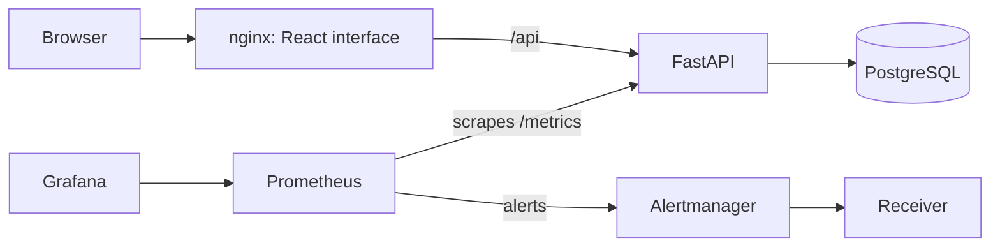
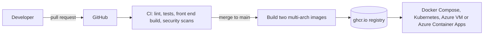
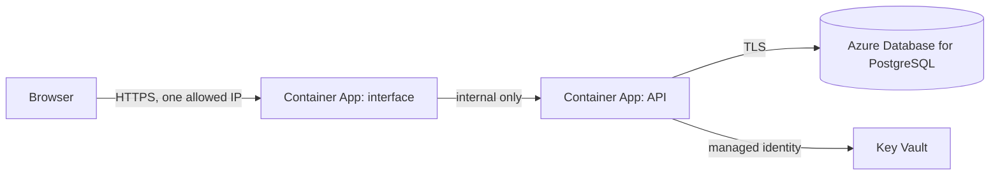

# TaskBoard

[](https://github.com/tamezza/TaskBoard/actions/workflows/ci.yml)


TaskBoard is a task board application, in the style of Trello: you create an account, open boards, and organise cards in columns ("To do", "Doing", "Done") by dragging them from one column to another. Each user sees only their own boards.

It has a **React** interface and a **FastAPI** back end with PostgreSQL, and comes with a complete delivery chain: automated tests, CI/CD pipelines with security scans, published Docker images, a Kubernetes deployment, cloud infrastructure defined with Terraform, passwordless releases from GitHub to Azure, and monitoring with Prometheus, Alertmanager and Grafana.

## Architecture





## Stack

| Area | Tools |
|---|---|
| Interface | React 19, TypeScript, Vite, served by nginx |
| API | Python 3.15, FastAPI, Pydantic, SQLAlchemy 2 |
| Accounts | Argon2 password hashing, signed tokens (JWT) |
| Database | PostgreSQL 17, schema migrations with Alembic (SQLite by default for local runs and CI) |
| Tests and quality | pytest, ruff, oxlint, TypeScript compiler |
| CI/CD | GitHub Actions (checks, image publication, release workflow with approval), Jenkins |
| Containers | Docker (multi-stage build for the interface), Docker Compose |
| Orchestration | Kubernetes (kind for local clusters) |
| Cloud and infrastructure as code | Microsoft Azure (Container Apps, managed PostgreSQL, Key Vault, virtual machine), Terraform, cloud-init |
| Monitoring | Prometheus (metrics and alert rules), Alertmanager (alert routing), Grafana (provisioned dashboard), liveness and readiness checks |
| Security | pip-audit, Trivy, Dependabot, non-root containers, secrets outside the repository, Azure Key Vault with a managed identity, OpenID Connect federation between GitHub and Azure |

## API

Every route except `/health`, `/ready`, `/metrics`, `/auth/register` and `/auth/login` requires an `Authorization: Bearer <token>` header.

| Method | Path | Description |
|---|---|---|
| POST | `/auth/register` | Create an account (`{"email": "...", "password": "..."}`), 409 if the email is taken |
| POST | `/auth/login` | Check the credentials and return an access token, valid for one hour |
| GET | `/auth/me` | The account that owns the token |
| GET | `/boards` | List your boards (`?archived=true` for the archived ones) |
| POST | `/boards` | Create a board (`{"name": "..."}`) with three default columns |
| GET | `/boards/{id}` | One board with its columns and cards |
| PATCH | `/boards/{id}` | Archive or restore a board (`{"archived": true}`) |
| DELETE | `/boards/{id}` | Delete a board and everything in it |
| POST | `/columns/{id}/cards` | Add a card to a column (`{"title": "..."}`) |
| PATCH | `/cards/{id}` | Edit a card (title, description, due date) |
| POST | `/cards/{id}/move` | Move a card (`{"column_id": 2, "position": 0}`) |
| DELETE | `/cards/{id}` | Delete a card |
| GET | `/ready` | Readiness check: 200 if the database answers a real query, 503 otherwise |
| GET | `/health` | Liveness check: the process is running |
| GET | `/metrics` | Prometheus metrics (request counts and durations) |

A request for a board, column or card that belongs to another user returns 404, the same answer as for one that does not exist. Unknown fields in a request body are rejected with 422.

Interactive documentation is generated by FastAPI at `/docs`.

## Quick start

### With Docker Compose (interface, API, PostgreSQL, Prometheus, Alertmanager, Grafana)

The database password and the key that signs the tokens are read from an untracked `.env` file:

```bash
cp .env.example .env        # then set your own POSTGRES_PASSWORD and SECRET_KEY in .env
docker compose up --build -d
```

Open http://localhost:8088, register an account and create a board.

| Service | Address |
|---|---|
| Interface | http://localhost:8088 |
| API | http://localhost:8000 (documentation at `/docs`) |
| Prometheus | http://localhost:9090 |
| Alertmanager | http://localhost:9093 |
| Grafana | http://localhost:3000 (default login `admin` / `admin`) |

Data is stored in a named volume, so boards survive `docker compose down` and `up`. The database schema is created and updated by Alembic migrations when the API container starts.

### API only, from the published image

```bash
docker run --rm -p 8000:8000 ghcr.io/tamezza/taskboard:latest
```

### Development, without Docker

The API, with automatic reload:

```bash
python3 -m venv .venv && source .venv/bin/activate
pip install -r requirements.txt -r requirements-dev.txt
alembic upgrade head
uvicorn app.main:app --reload
```

Without a `DATABASE_URL` environment variable, the API uses a local SQLite file.

The interface, in a second terminal (Node.js 22.12 or later):

```bash
cd frontend
npm install
npm run dev
```

Open http://localhost:5173. The development server forwards `/api` to the API on port 8000, as nginx does in the container.

## Tests

```bash
ruff check .
python -m pytest -v          # API tests, including access control between users
cd frontend
npm run lint                 # oxlint
npm run build                # type check, then production build
```

## CI/CD

The pipeline is defined in [`.github/workflows/ci.yml`](.github/workflows/ci.yml) and has four jobs.

| Job | When | What it does |
|---|---|---|
| `test` | Every pull request and every push to `main` | Lint with ruff, run the tests |
| `frontend` | Every pull request and every push to `main` | Install the exact locked packages, lint, type-check and build the interface, build its image and scan it with Trivy |
| `security` | Every pull request and every push to `main` | Audit Python dependencies with pip-audit, build the image and scan it with Trivy (fails on HIGH or CRITICAL findings that have a fix) |
| `publish` | Push to `main` only, after the three other jobs pass | Build the API and interface images for `linux/amd64` and `linux/arm64` and push them to `ghcr.io/tamezza/taskboard` and `ghcr.io/tamezza/taskboard-web`, tagged `latest` and with the commit SHA |

The `main` branch is protected: changes arrive through pull requests, and the `test`, `frontend` and `security` checks must pass before merging. The SHA tag makes every build traceable and allows rollbacks.

The same install, lint and test stages are also available for Jenkins in the [`Jenkinsfile`](Jenkinsfile). The image for a Jenkins server with Python is in [`jenkins/Dockerfile`](jenkins/Dockerfile).

## Kubernetes

The manifests in [`k8s/`](k8s) deploy PostgreSQL and three replicas of the API behind a Service. The database password and the token signing key come from a Kubernetes Secret, created by a command and never stored in a file:

```bash
kind create cluster --name taskboard --config k8s/kind-config.yaml
kubectl create secret generic taskboard-db \
  --from-literal=password="$(openssl rand -hex 16)" \
  --from-literal=secret-key="$(openssl rand -hex 32)"
kubectl apply -f k8s/db.yaml
kubectl rollout status deployment/db
kubectl apply -f k8s/api.yaml
kubectl rollout status deployment/taskboard
kubectl port-forward service/taskboard 8000:80
```

What the deployment demonstrates:

- **Self-healing:** a deleted pod is replaced automatically to keep three replicas.
- **Rolling updates:** new pods must pass the `/ready` readiness probe, which queries the database, before old ones are removed, so there is no interruption.
- **Two probes, two reactions:** a pod that fails `/ready` stops receiving traffic but keeps running; a pod that fails `/health` is restarted. A database outage therefore does not restart the API in a loop.
- **Rollback:** `kubectl rollout undo deployment/taskboard` returns to the previous version.
- **Shared state:** all replicas use the same PostgreSQL database and the same signing key, so a token issued by one replica is accepted by the others.

## Cloud deployment with Terraform (Azure)

[`infra/main.tf`](infra/main.tf) describes a complete deployment on Azure: resource group, virtual network, subnet, public IP, network security group, network interface and a Linux virtual machine. On first boot, [`infra/cloud-init.yaml`](infra/cloud-init.yaml) installs Docker and runs the published image, so nobody logs in to the server.

```bash
cd infra
az login
export ARM_SUBSCRIPTION_ID=$(az account show --query id --output tsv)
terraform init
terraform plan  -var "my_ip=$(curl -s https://checkip.amazonaws.com)"
terraform apply -var "my_ip=$(curl -s https://checkip.amazonaws.com)"
curl http://$(terraform output -raw public_ip):8000/health
terraform destroy -var "my_ip=$(curl -s https://checkip.amazonaws.com)"
```

The firewall rule opens port 8000 to the caller's IP address only, and SSH is not exposed. The Terraform state file is excluded from Git because it contains secrets.

## Cloud deployment with managed services (Azure Container Apps)

[`infra/containerapps/main.tf`](infra/containerapps/main.tf) deploys the whole application on managed services: the two published images on Azure Container Apps, and the data in Azure Database for PostgreSQL.



```bash
cd infra/containerapps
az login
export ARM_SUBSCRIPTION_ID=$(az account show --query id --output tsv)
terraform init
terraform apply -var "my_ip=$(curl -4 -s https://checkip.amazonaws.com)"
az containerapp job start --name taskboard-migrate --resource-group taskboard-app-rg
terraform output url
terraform destroy -var "my_ip=$(curl -4 -s https://checkip.amazonaws.com)"
```

- Only the interface has a public address, served over HTTPS with a certificate managed by Azure, and restricted to the caller's IP address. The API accepts connections from inside the environment only.
- The database password and the token signing key are generated by Terraform and stored in Azure Key Vault. The API reads them at start-up through a managed identity that has read-only access to that vault, so no credential for the vault exists anywhere.
- Database migrations run as a separate job, started once per release, before the new version receives traffic. The API containers only serve requests, so several replicas can start at the same time without racing to change the schema.
- Both containers scale to zero when nobody uses the application, so an idle deployment costs nothing for compute.
- If the region has no capacity for the database, `-var "db_location=northeurope"` places it in another region while the rest stays in place.

### Releasing a version

A new version is released by the [`Deploy`](.github/workflows/deploy.yml) workflow, started by hand from the Actions tab with the commit identifier to release. After approval by a reviewer of the `azure` environment, it runs the migration job, waits for it to succeed, then switches the API and the interface to that version. If the migration fails, the containers keep running the previous version.

GitHub logs in to Azure without any stored password. Terraform creates an identity that trusts tokens issued by GitHub for this repository and this environment only (OpenID Connect federation), with rights limited to the application's resource group.

## Monitoring

The API exposes Prometheus metrics at `/metrics`, and two checks: `/health` says the process is running, `/ready` says it can serve a real request because the database answers a query. The Compose stack includes:

- **Prometheus**, configured in [`monitoring/prometheus.yml`](monitoring/prometheus.yml), scraping the API every 5 seconds, with two alert rules in [`monitoring/alerts.yml`](monitoring/alerts.yml):
  - `TaskboardDown` (critical): the API has been unreachable for 30 seconds.
  - `TaskboardErrors` (warning): the API is reachable but answers with server errors.
- **Alertmanager**, configured in [`monitoring/alertmanager.yml`](monitoring/alertmanager.yml), which groups the alerts and sends them, firing and resolved, to a receiver. The receiver in this repository, [`monitoring/receiver.py`](monitoring/receiver.py), is a small script that prints each alert; replacing it with email or chat is a change in that one file.
- **Grafana**, with its data source and a `TaskBoard` dashboard provisioned from files in [`monitoring/grafana/`](monitoring/grafana): requests per second by status, and 95th percentile latency.

The API writes one line of JSON per request, with its method, path, status, duration and a request identifier. The same identifier is returned to the caller in the `X-Request-ID` header, so a problem reported by a user can be traced to its exact log line. Health checks and metric scrapes are not logged.

Nothing is configured by hand: `docker compose up` recreates the dashboard, the rules and the alert routing from the repository.

The second rule exists because of an incident during a cloud deployment: the API answered 200 on `/health` while every real request failed, the database schema not having been migrated yet. An alert on unreachability alone stays silent in that case.

To see the chain work:

```bash
docker compose logs -f --tail 0 receiver     # in a second terminal
docker compose stop api                      # FIRING TaskboardDown after about 45 seconds
docker compose start api                     # RESOLVED TaskboardDown
```

## Security

- **Passwords:** stored as Argon2 hashes, never in clear text. A failed login gives the same answer whether the email or the password is wrong.
- **Access control:** every board, column and card is checked against the owner of the token, and tested with two users.
- **No secrets in the repository:** Compose reads the database password and the signing key from an untracked `.env` file, Kubernetes from a Secret.
- **Least privilege:** both containers run as non-root users, the pipeline token is read-only by default, and only the `publish` job can write packages.
- **Scanning in the pipeline:** pip-audit for Python dependencies and Trivy for both images. An image with fixable HIGH or CRITICAL findings is not published.
- **Pinned third-party action:** the Trivy action is referenced by a full commit SHA, not a tag, so its code cannot change silently.
- **Dependency updates:** Dependabot proposes updates for Python packages, JavaScript packages, the Docker base images and GitHub Actions.

The first image scan reported 6 HIGH findings, none in the application's own dependencies: one in a system library from the base image, and five in packages bundled inside pip. They were fixed by applying Debian security updates at build time and removing pip from the runtime image.

## Project structure

```
app/                  FastAPI application: accounts (auth.py, security.py), boards and cards (boards.py), models
migrations/           Alembic migrations of the database schema
tests/                API tests
frontend/             React interface (src/), its Dockerfile and nginx configuration
.github/              GitHub Actions pipeline, release workflow and Dependabot configuration
jenkins/              Dockerfile for a Jenkins server with Python
k8s/                  Kubernetes manifests and kind cluster configuration
infra/                Terraform for Azure: a virtual machine (main.tf) and managed services (containerapps/)
monitoring/           Prometheus configuration, alert rules, Alertmanager routing and receiver, Grafana provisioning
Dockerfile            Image of the API
compose.yaml          Local stack: interface, API, PostgreSQL, Prometheus, Alertmanager, Grafana
Jenkinsfile           Jenkins pipeline
.env.example          Template for the local .env file
```

## Known limitations and possible next steps

- The cloud deployment is created for demonstrations and destroyed afterwards. It is not a permanent service.
- In the cloud deployment the database has a public endpoint that accepts connections from Azure services only, protected by TLS and a generated password. A private network link would remove that endpoint.
- The Terraform state is kept locally and contains the generated secrets, which is why that file is never committed. A team would keep it in a shared, locked and encrypted remote backend.
- The Kubernetes manifests and the Azure virtual machine deploy the API only, not yet the interface.
- In Docker Compose, Kubernetes and on the virtual machine, migrations still run when the API container starts, which is only safe with one replica. The Container Apps deployment runs them as a separate job.
- The interface keeps the access token in the browser's local storage, which a malicious script injected in the page could read. An HttpOnly cookie is the usual hardening.
- Boards are personal. Sharing a board with other users is planned for the next version.
- The development password used in early commits is still visible in the Git history. It has been replaced and is no longer used anywhere.
- Alerts are routed to a local receiver that prints them. A real deployment would send them to email, chat or an on-call service.
- The database has no backup procedure in the local stack, and no restore has been tested.

## Author

**Thiziri Amezza** · [GitHub](https://github.com/tamezza) · [LinkedIn](https://www.linkedin.com/in/amezzathiziri/)